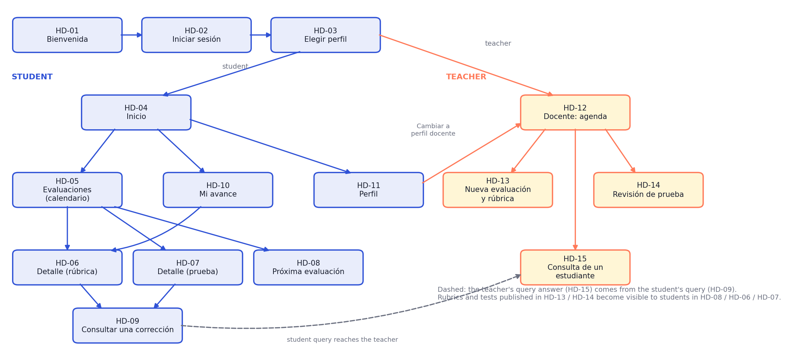
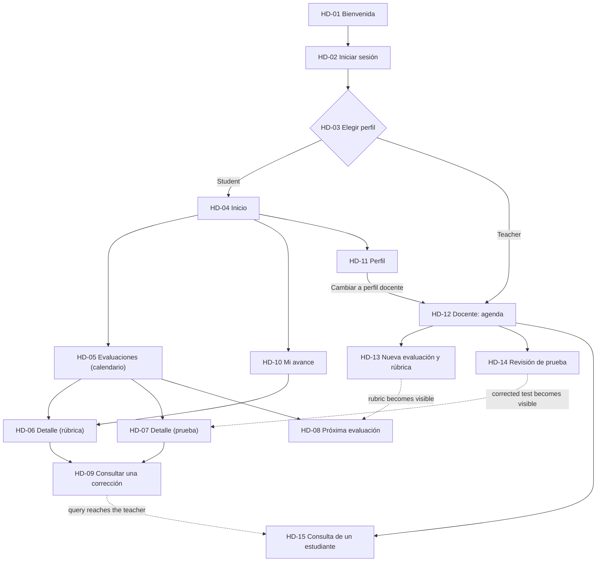

# Redo

*Feedback on assessments that students actually use*

Documentation repository for the UX project of **Group 5** (HCI / UXD 2026-2, Initiative 03). **Redo** is a mobile app that gathers, in one place, the calendar of assessments, the rubrics and corrected tests, and the student's progress, so that feedback is something students read, question and use to prepare their next assessment.

**High-fidelity prototype (Figma):** [Redo – HD screens](https://www.figma.com/design/cwB8ZiCmUKTIgNYHercjWv)

## Team

| Member | Role |
| --- | --- |
| Emilia Toro | Project Lead |
| Cristian Sandoval | Designer |
| Bastian Wenckhans | Analyst |

## Selected project

Feedback on assessments usually reaches students as a final grade, plus comments scattered across PDF files, spreadsheets and emails. Rubrics are published late or not at all, students cannot tell which criteria or questions cost them points, they do not know how their result compares with the course, and when they disagree with a correction they have no clear and respectful way to ask.

The challenge is to **make feedback usable**: before an assessment, the student can see the rubric and prepare; after it, the student can see exactly where points were lost and why, can place the result in context, and can send the teacher a precise query about a specific criterion or question.

### Main user story

> As a student who received a low grade, I need to see exactly which criterion or question cost me points, and why, so that I can prepare better for the next assessment and ask my teacher about any correction I do not understand.

### Design goal

Design an experience that connects **upcoming assessment → published rubric → corrected result → context (course average, highest, lowest) → progress over time → structured query to the teacher**, with a matching teacher side that publishes rubrics and tests, reviews them with correct answers and a final comment, and answers student queries.

The [project brief](docs/project-brief.md) develops the problem, the research findings, the scope and the questions to validate.

## High-fidelity screens

The prototype has **15 screens** (390 × 844 px, mobile), one design system (Plus Jakarta Sans; cobalt blue, warm off-white, ink, yellow and coral accents) and a clickable prototype. The interface is in Spanish; the documentation is in English. Open any screen directly in Figma:

| ID | Screen (Figma name) | Actor | Purpose |
| :-: | :--- | :--- | :--- |
| HD-01 | [Bienvenida](https://www.figma.com/design/cwB8ZiCmUKTIgNYHercjWv?node-id=30-636) | All | Welcome and entry to the app. |
| HD-02 | [Iniciar sesión](https://www.figma.com/design/cwB8ZiCmUKTIgNYHercjWv?node-id=30-652) | All | Sign in with the institutional account. |
| HD-03 | [Elegir perfil](https://www.figma.com/design/cwB8ZiCmUKTIgNYHercjWv?node-id=30-686) | All | Choose the student or the teacher profile. |
| HD-04 | [Inicio](https://www.figma.com/design/cwB8ZiCmUKTIgNYHercjWv?node-id=24-661) | Student | Next assessments and latest results. |
| HD-05 | [Evaluaciones (calendario)](https://www.figma.com/design/cwB8ZiCmUKTIgNYHercjWv?node-id=24-787) | Student | Monthly calendar of assessments, with state per day. |
| HD-06 | [Detalle (rúbrica)](https://www.figma.com/design/cwB8ZiCmUKTIgNYHercjWv?node-id=24-1010) | Student | Grade, total achievement, course average and criterion-by-criterion points. |
| HD-07 | [Detalle (prueba)](https://www.figma.com/design/cwB8ZiCmUKTIgNYHercjWv?node-id=25-292) | Student | Incorrect questions with the correct answer and the teacher's final comment. |
| HD-08 | [Próxima evaluación](https://www.figma.com/design/cwB8ZiCmUKTIgNYHercjWv?node-id=25-405) | Student | Published rubric of an upcoming assessment, to prepare. |
| HD-09 | [Consultar una corrección](https://www.figma.com/design/cwB8ZiCmUKTIgNYHercjWv?node-id=25-542) | Student | Structured message to the teacher, anchored to a criterion or question. |
| HD-10 | [Mi avance](https://www.figma.com/design/cwB8ZiCmUKTIgNYHercjWv?node-id=26-414) | Student | Own grades vs. course average, highest and lowest; chart; biggest error. |
| HD-11 | [Perfil](https://www.figma.com/design/cwB8ZiCmUKTIgNYHercjWv?node-id=26-614) | Student | Student data, courses of the semester, switch to teacher profile. |
| HD-12 | [Docente: agenda](https://www.figma.com/design/cwB8ZiCmUKTIgNYHercjWv?node-id=27-498) | Teacher | Schedule of assessments and pending queries. |
| HD-13 | [Nueva evaluación y rúbrica](https://www.figma.com/design/cwB8ZiCmUKTIgNYHercjWv?node-id=27-618) | Teacher | Schedule an assessment; publish a rubric (criteria and weights, or file) or a test. |
| HD-14 | [Revisión de prueba](https://www.figma.com/design/cwB8ZiCmUKTIgNYHercjWv?node-id=27-705) | Teacher | Review a test with a correct-answers sheet and a final comment. |
| HD-15 | [Consulta de un estudiante](https://www.figma.com/design/cwB8ZiCmUKTIgNYHercjWv?node-id=27-838) | Teacher | Answer a student's query; the score can be adjusted once. |

The student navigates with a four-tab bar (Inicio, Evaluaciones, Progreso, Perfil) and the teacher with a three-tab bar (Agenda, Mensajes, Perfil).

### Navigation flow



The same flow as an interactive diagram (rendered by GitHub):



## UX Elements Architecture (Jesse James Garrett)

Each UX Research and design technique in the project is anchored to one of the five planes of Jesse James Garrett's *The Elements of User Experience*:

| Plane | Techniques | Deliverables | Objective |
| :--- | :--- | :--- | :--- |
| **1. Strategy** *(Estrategia)* | Semi-structured interviews (3 participants), thematic analysis, personas, Value Proposition Canvas. | [Research report](docs/user-research-interviews.pdf), [UX personas](docs/user-personas.pdf), [Value Proposition Canvas](docs/value-proposition-canvas-full.pdf), [Project brief](docs/project-brief.md) | Understand how feedback is received and used today, and define the value Redo offers. |
| **2. Scope** *(Alcance)* | Competitive and analogous benchmarking, ERIC matrix, definition of flows and boundaries. | [Benchmarking report](docs/benchmarking-report.pdf), [Scope & UX elements](docs/scope-and-ux-elements.pdf) | Bound the solution to one core flow and two secondary flows, with a justification of what stays out. |
| **3. Structure** *(Estructura)* | Customer Journey Map, navigation flow, information architecture. | [Customer Journey Map](docs/Customer-Journey-Map.pdf), navigation flow (above), journey-to-screen mapping | Organize how the student moves from knowing an assessment is coming to tracking progress. |
| **4. Skeleton** *(Esqueleto)* | Paper low-fi sketches, wireframes. | Digitized low-fi sketches *(to be added by the team)* | Define layout, hierarchy and controls of each screen. |
| **5. Surface** *(Superficie)* | HD prototype, design system, visual identity. | [Figma HD prototype](https://www.figma.com/design/cwB8ZiCmUKTIgNYHercjWv) | Final look in Spanish: typography, color tokens, components and the Redo logo. |

*Detailed document:* [Scope delimitation, UX elements and journey-to-screen mapping](docs/scope-and-ux-elements.pdf).

## Completed activities

### 1. User research and UX personas

Three semi-structured interviews (two students and one teacher, 30–40 minutes each, with informed consent) were run in October 2026 and analysed thematically. The protocol, guide, participant summaries and findings are in the [User Research report](docs/user-research-interviews.pdf), and the findings are summarized in the [project brief](docs/project-brief.md). They gave rise to three personas:

| Persona | Age | Field and role | Institution | Relation to Redo |
| --- | --- | --- | --- | --- |
| Valentina Rojas | 20 | Computer engineering student, primary user. | Universidad de La Frontera | Checks her calendar, opens the rubric or corrected test to see where she lost points, and follows her progress. |
| Samon Baker | 21 | Graphic design student and intern, primary user. | INACAP | Prepares for assessments with the published rubric and compares his results with the course. |
| Martina Soto | 29 | University instructor in education, secondary user. | Universidad Católica de Temuco | Schedules assessments, publishes rubrics and tests, reviews them and answers student queries. |

The three profiles are set in Temuco, Chile. The prototype is set in a single institutional environment (UFRO) to validate the interaction mechanics; the differences between personas inform needs, not institutional integration.

#### Valentina Rojas


#### Samon Baker


#### Martina Soto


- [View the PDF with the three UX personas](docs/user-personas.pdf).

### 2. Value Proposition Canvas

The canvas aligns the needs of the three personas with what Redo offers. Initial exploratory board: [original canvas](docs/value-proposition-canvas.pdf). Calibrated canvas: [Value Proposition Canvas and strategy brief](docs/value-proposition-canvas-full.pdf).


| Persona | Customer jobs | Pains relieved | Gains created | Redo capability (screens) |
| :--- | :--- | :--- | :--- | :--- |
| **Valentina Rojas** *(primary)* | Understand where she lost points and ask about a correction she does not understand. | Receiving only a number; generic comments; not knowing how to ask without confrontation. | Seeing points per criterion and the correct answer; asking with a message anchored to that criterion. | Rubric and test detail, query (HD-06, HD-07, HD-09) |
| **Samon Baker** *(primary)* | Prepare for upcoming assessments and see whether he is improving. | Learning the rubric after the assessment; no sense of where he stands. | Published rubric in advance; comparison with course average, highest and lowest; biggest error. | Calendar, next assessment, progress (HD-05, HD-08, HD-10) |
| **Martina Soto** *(secondary)* | Publish rubrics and tests, give useful feedback and answer queries efficiently. | Repeated questions by email; rubrics scattered across files; unstructured queries. | One place to schedule, publish, review and answer, with the score adjustable once. | Teacher agenda, publish, review, answer (HD-12 to HD-15) |

### 3. Benchmarking

Exploratory and competitive benchmark of how educational and collaborative tools present assessments, rubrics and results. It includes an exploration protocol, annotated teardowns of each tool, a comparison matrix, an ERIC matrix (Eliminate, Reduce, Raise, Create) and an idea map that connects the patterns found to Redo's modules.

* **Full report:** [Benchmarking report](docs/benchmarking-report.pdf).
* **Synthesis board:** [Benchmarking board](docs/Benchmarking.pdf).


| Tool | Category | Key finding and contribution to the design |
| --- | --- | --- |
| Moodle (Campus Virtual UFRO) | Direct competitor | Rubric levels are highlighted, but comments sit in small cells and there is no course context. |
| Canvas LMS | Direct competitor | Criterion-level remarks and a grades view with course statistics; inspires the comparison in *Mi avance*. |
| Google Classroom | Direct competitor | Clear assessment list and due dates; feedback is separate from specific criteria. |
| Intranet UFRO | Baseline | Static grade display, no rubric and no way to ask about a grade. |
| Google Calendar | Analogous reference | Monthly grid with day markers; inspires the assessments calendar (HD-05). |
| Duolingo / Khan Academy | Analogous reference | Progress charts and review of wrong answers with the correct one; inspires HD-07 and HD-10. |

### 4. Customer Journey Map

A single general journey in six stages, from knowing that an assessment is coming to tracking progress: **Know, Prepare, Receive, Understand, Ask, Track**. It includes scenario, expectations, actions, touchpoints, teacher actions, thoughts, emotional curve, pain points and opportunities.


* [Customer Journey Map PDF](docs/Customer-Journey-Map.pdf).

#### Journey-to-screen mapping

| Stage | What the student does | Emotional state | Screens | Teacher counterpart |
| :--- | :--- | :--- | :--- | :--- |
| **01 Know** | Checks which assessments are coming and when. | Uncertain | HD-04, HD-05 | Schedules the assessment (HD-12, HD-13). |
| **02 Prepare** | Reads the published rubric to know what will be evaluated. | Focused | HD-08 | Publishes criteria and weights, or a file (HD-13). |
| **03 Receive** | Opens the result and sees grade, achievement and course average. | Anxious | HD-04, HD-06, HD-07 | Reviews the test and writes a final comment (HD-14). |
| **04 Understand** | Sees points per criterion, or incorrect questions with the correct answer. | Reassured | HD-06, HD-07 | — |
| **05 Ask** | Sends a structured message about a criterion or question. | Hopeful | HD-09 | Answers and may adjust the score once (HD-15). |
| **06 Track** | Compares own grades with the course and finds the biggest error. | Encouraged | HD-10, HD-11 | — |

## Delimitation of Scope

The scope is **everything built in the 15 HD screens**, organized in one core flow and two secondary flows, plus supporting screens.

### 1. Core flow: prepare and understand a result
* **Actors:** student (Valentina, Samon) and teacher (Martina).
* **Steps:**
  1. The teacher schedules an assessment and publishes its rubric or test (HD-12, HD-13).
  2. The student sees it on the calendar and reads the rubric to prepare (HD-05, HD-08).
  3. After the assessment, the teacher reviews it with a correct-answers sheet and a final comment (HD-14).
  4. The student opens the result and sees points per criterion, or incorrect questions with the correct answer, plus the course average (HD-06, HD-07).

### 2. Secondary flow 1: query a correction
* **Actors:** student and teacher.
* **Steps:** the student sends a message anchored to a criterion or question (HD-09); the teacher answers and may adjust the score once (HD-15).

### 3. Secondary flow 2: follow progress
* **Actor:** student.
* **Steps:** the student reviews own grades against the course average, highest and lowest, a line chart and the biggest error (HD-10).

### 4. Supporting screens
Welcome, sign in, profile choice and student profile (HD-01 to HD-03, HD-11), with the switch to the teacher profile.

### 5. Out of scope and why

| Feature | Decision | Justification |
| :--- | :---: | :--- |
| Evidence upload and corrective action cards | Excluded | Students only *view* feedback; the research showed the need is understanding and asking, not submitting more work. |
| Integration with the UFRO intranet or Moodle | Excluded | The prototype uses its own data to validate the interaction before tackling institutional APIs. |
| Free chat with the teacher | Excluded | Queries are structured and tied to a criterion or question, to avoid teacher overload and keep the context. |
| Final-grade calculator and full gradebook | Excluded | Institutional systems already compute averages; Redo compares results, it does not replace the gradebook. |
| Automated grading with AI | Excluded | The course prohibits it in this milestone. |
| Multi-institution synchronization | Excluded | The prototype assumes one institutional environment. |

## Traceability of design decisions

| Need or difficulty | Design response | Screens | Evidence to collect |
| --- | --- | :-: | --- |
| Not knowing what will be evaluated | Rubric published before the assessment. | HD-08 | The student can say what will be evaluated. |
| Receiving only a number | Points per criterion, or incorrect questions with the correct answer. | HD-06, HD-07 | The student identifies where points were lost. |
| Not knowing where one stands | Course average, highest and lowest next to the result. | HD-06, HD-10 | The student places the result in the course. |
| Repeating the same mistakes | Biggest error highlighted in *Mi avance*. | HD-10 | The student names what to improve. |
| Not knowing how to question a correction | Structured message anchored to the criterion. | HD-09 | The student finds and uses the query. |
| Teacher overloaded with scattered queries | One place to schedule, publish, review and answer. | HD-12 to HD-15 | The teacher answers a query without extra channels. |

## Proposed validation

The prototype is to be tested with students who have recently received graded feedback and with teachers who publish rubrics. A first test asks participants to find the next assessment, read its rubric, locate where they lost points, send a query and read their progress.

| Dimension | Proposed indicator |
| --- | --- |
| Understanding | Share of participants who correctly identify where they lost points. |
| Ease of use | Time, errors and help needed to complete each task. |
| Usefulness of preparation | Share who say the published rubric changes how they prepare. |
| Queries | Share who can send a structured query and teachers who can answer it without extra channels. |

Opening a comment does not show by itself that the feedback was used, and a better grade does not show by itself that the tool caused it. Numeric targets and sample sizes will be defined in Milestone 2.

## Status and next steps

| Activity | Status |
| --- | --- |
| Problem definition and user story | Completed. |
| User research and personas | Completed. |
| Value Proposition Canvas, benchmarking, Customer Journey Map | Completed. |
| Scope and UX elements | Completed. |
| High-fidelity prototype in Figma (15 screens) | Completed. |
| Paper low-fi sketches (digitization) | Pending: to be added by the team. |
| AI Usage Log | Pending: to be written by the team. |
| Presentation | Pending: to be prepared by the team. |
| Usability testing | Scheduled for Milestone 2. |

## AI Usage Log

*To be completed by the team.*

## Repository contents

```text
.
├── README.md
├── docs/
│   ├── project-brief.md
│   ├── user-research-interviews.pdf
│   ├── user-personas.pdf
│   ├── value-proposition-canvas-full.pdf
│   ├── value-proposition-canvas.pdf
│   ├── benchmarking-report.pdf
│   ├── Benchmarking.pdf
│   ├── Customer-Journey-Map.pdf
│   └── scope-and-ux-elements.pdf
├── ux-personas/
│   ├── 1.png
│   ├── 2.png
│   └── 3.png
└── images/
    ├── value_proposition.png
    ├── benchmarking.png
    ├── customer-journey-map.png
    └── navigation-flow.png
```

The documentation is in English; the app interface is in Spanish. This repository documents a UX proposal; it contains no runnable application, so there are no installation or run instructions.
