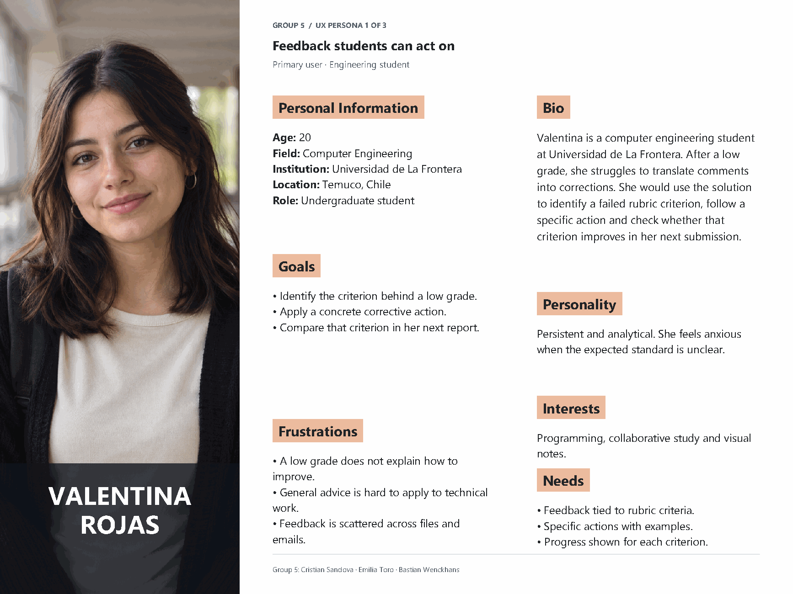
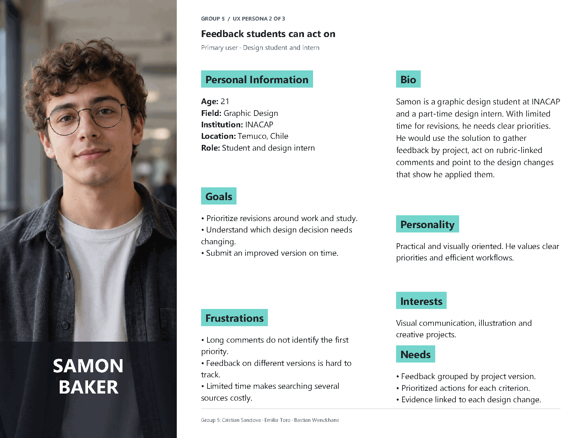
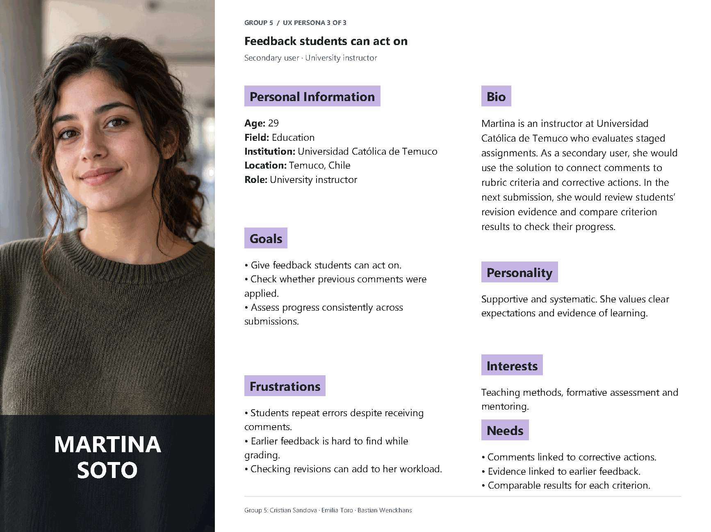

# Feedback on assessments that students actually use

Documentation repository for the UX project of **group 5**. The project aims to turn the feedback on an assessment into a concrete correction in the next submission, and to let students check their progress by rubric criterion.

## Team

| Member |
| --- |
| Cristian Sandova |
| Emilia Toro |
| Bastian Wenckhans |

## Selected project

Feedback on assignments and rubrics arrives late and scattered across PDF comments, spreadsheets and emails. This makes it hard for students to understand what failed and to apply the comments before their next submission.

The challenge is to **close the feedback loop**: identify the criterion that failed, understand which concrete action corrects it, and check whether there was an improvement over the previous submission. The functional surface is small, and the design focus is on the clarity of the information and on evidence that the feedback was used.

### Main user story

> As a student who got a low grade on the first submission, I need to see exactly which criterion failed and what I should do differently next time, so that I do not repeat the same mistake without noticing.

### Design goal

Design an experience that connects **evaluated criterion → detected difficulty → improvement action → evidence of application → result of the next submission**.

The value proposition is to help students turn the comments of an assessment into understandable and verifiable actions for their next piece of work.

The [project brief](docs/project-brief.md) develops the problem, the proposed scope and the questions to validate with users.

## Completed activities

### 1. UX personas

Three distinct profiles were created, with different fields, institutions and roles. Two represent the students who receive and apply the feedback. The third represents the instructor who gives it and reviews the evidence of correction.

They are **preliminary personas or proto-personas**. Their traits and institutions are part of the design scenario and must be validated with users. They do not represent interviewed participants or an institutional implementation. The shared materials include no interview, survey or test records.

| Persona | Age | Field and role | Institution | Relation to the solution |
| --- | --- | --- | --- | --- |
| Valentina Rojas | 20 | Computer engineering student, primary user. | Universidad de La Frontera | Identifies the failed criterion, follows a corrective action and compares her result in the next submission. |
| Samon Baker | 21 | Graphic design student and intern, primary user. | INACAP | Gathers comments by project, prioritizes revisions and links each action to evidence of the change in his design. |
| Martina Soto | 29 | University instructor in education, secondary user. | Universidad Católica de Temuco | Relates comments to criteria and actions, reviews the evidence of correction and compares results across submissions. |

The three profiles are set in Temuco, Chile. Their differences point to concrete interaction needs: clarity for Valentina, prioritization for Samon and follow-up on application for Martina.

#### Valentina Rojas



#### Samon Baker



#### Martina Soto



[View the PDF with the three UX personas](docs/user-personas.pdf).

The profiles are written in English and share a structure of personal information, biography, goals, frustrations, personality, interests and needs. The layout places the photo on the left and the information in two columns on the right. Only the name appears over the photos, while the field, institution and role appear in the personal information.

### 2. Value Proposition Canvas

The canvas relates the student's jobs, frustrations and expected gains to the features and mechanisms proposed to make feedback easier to use.


[View the original canvas PDF](docs/value-proposition-canvas.pdf).

| Component | Content of the current canvas |
| --- | --- |
| Student jobs | Organize the academic schedule, know the evaluation criteria, understand previous errors and carry out corrective actions in later submissions. |
| Pains | Fragmented information, unawareness of evaluation parameters, late feedback and ambiguous comments. |
| Gains | Clarity on improvement steps, evidence of progress, centralized information and transparent evaluation. |
| Products and services | Academic dashboard, rubrics module, progress panel and links between failed criteria and corrective actions. |
| Pain relievers | Turn abstract comments into actionable guidance, show the rubric in advance and bring academic information together. |
| Gain creators | Support self-evaluation, focus study time and show the student's progress. |

The link between criterion and corrective action answers the problem directly. For the next iteration, the proposal is to prioritize it together with evidence of application and comparison by criterion. The schedule, timetables and centralization of all academic information are complementary features that need to justify their contribution to the main goal.

### 3. Benchmarking

A single board with four quadrants (Increase, Include, Reduce, Remove) that compares how seven tools show results and feedback to a student today. Each card shows its source product and the persona it answers to.


[View the benchmarking PDF](docs/benchmarking.pdf).

| Tool | Contribution to the comparison |
| --- | --- |
| Intranet UFRO | Observed by the team. It shows grades, like the Campus Virtual. There is no public documentation, so no features are cited. |
| Moodle (Campus Virtual UFRO) | Rubric with criteria and levels, comment per criterion and rubric preview. |
| Canvas | Rubric results by criterion and a learning mastery view. |
| Google Classroom | Rubric level highlighted in the returned assignment. |
| Microsoft Teams (Assignments) | Return for revision with a "Needs revision" status and an overall feedback box. |
| GitHub (pull requests) | Comments on specific lines, resolved conversations and re-requested review. |
| Figma (comments) | Pinned comments, resolving and version history. |

The features of each tool were checked in its official documentation. No institutional accounts were tested and no usability was measured, so the decisions are design inferences.

### 4. Customer Journey Map

A single general journey, not one per persona, in six stages: receive the result, find the feedback, understand it, revise, submit and check progress. It includes scenario, expectations, actions, touchpoints, instructor actions, thoughts, emotional curve, pain points and opportunities. It starts from Valentina Rojas and Samon Baker as primary users and Martina Soto as the secondary user.


[View the customer journey map PDF](docs/customer-journey-map.pdf).

The thoughts and emotions are an example case built from the personas and must be validated with users.

## Proposed functional scope

These functions describe the design direction for a prototype. Their implementation and validation are pending.

1. **Assessment review:** see criteria, the level or score obtained and the associated comment.
2. **Improvement action:** understand what to change, why, and how to recognize that the correction is done.
3. **Application record:** link the action to a specific fragment, section or change in the next submission.
4. **Comparison across submissions:** review the result of the same criterion when the rubrics are comparable.

The initial experience can focus on one course and two related submissions. The instructor acts as a secondary user: she links comments to criteria and actions, and reviews the evidence provided by the student. Notifications can help students learn that comments are available, but they do not show that the comments were understood or applied.

## Proposed main flow

1. The student opens the feedback on the first submission.
2. They identify a criterion that did not reach the expected level.
3. They review an explanation and a concrete improvement action linked to that criterion.
4. They apply the action in the next submission and record where the change was made.
5. The instructor reviews the change linked to the action and evaluates the new submission.
6. The student compares the result for that criterion with the previous submission, when the rubrics are equivalent.

### Illustrative example

This example explains the proposal. It is not a finding and does not come from a test.

| Step | Example |
| --- | --- |
| Criterion | Justification of design decisions. |
| Difficulty | The first submission presents a decision without linking it to user evidence. |
| Concrete action | Add the evidence that supports the decision and explain how it relates to the user's problem. |
| Evidence of application | Point to the section of the second submission where that justification was added. |
| Check | Review the level reached on the same criterion in the second assessment. |

## Traceability of design decisions

The following table links needs described in the materials to design proposals and ways to validate them. It does not represent research results.

| Need or difficulty | Proposed response | Evidence to collect |
| --- | --- | --- |
| Not knowing which criterion failed | Present criterion, result and comment together. | The student correctly identifies the criterion and explains the difficulty. |
| Not understanding what to correct | Show a specific action and a relevant example. | The student explains in their own words what they will change. |
| Reviewing separate files and emails | Bring the feedback of the submission into one view. | They find the relevant comment without going through several sources. |
| Repeating mistakes | Link improvement actions to evidence in the next submission. | A concrete change linked to the earlier comment is identified. |
| Not recognizing progress | Compare the result of the same criterion across submissions. | They recognize whether performance improved, stayed the same or got worse. |
| Little time to review design projects | Prioritize actions and gather comments by version. | The student finds a relevant action and points to the change made. |
| Instructor difficulty verifying application | Link evidence in the next submission to each earlier comment. | The instructor identifies the correction and evaluates it against the same criterion. |

## Proposed validation

The proposal is to test the prototype with engineering and design students who have received feedback and must make a related later submission. Instructors would help review the clarity of the actions and the effort of verifying corrections. An initial test can ask participants to locate a weak criterion, explain the correction, record evidence and read the comparison across submissions.

| Dimension | Proposed indicator |
| --- | --- |
| Understanding of the problem | Share of participants who correctly identify the criterion to improve. |
| Clarity of the action | Share who describe a concrete correction consistent with the comment and the rubric. |
| Ease of use | Time, errors and help needed to find and understand the feedback. |
| Application | Share of actions with relevant evidence in the next submission. |
| Progress | Change in level or score on the same criterion across comparable assessments. |

**Opening a comment or marking a task as done does not show by itself that the feedback was applied.** Applying it requires evidence in the work. A better grade does not show by itself that the tool caused the improvement either. Numeric targets and test sizes will be defined when the research is prepared.

## Status and next steps

| Activity | Status |
| --- | --- |
| Initial definition of the problem and the user story | Available. |
| UX personas | Three profiles updated in English, with distinct roles and institutions. Validation pending. |
| Value Proposition Canvas | Available. Scope needs prioritization. |
| Benchmarking | Available. Based on official documentation and team use, with no user testing. |
| Customer Journey Map | Available. General journey based on the personas, validation pending. |
| Research with students and instructors | Pending. No evidence attached. |
| Flow and prototype design | Proposed. No prototypes attached. |
| Usability testing and application tracking | Pending. |
| High-fidelity interface proposal | Pending. |

The next steps are to validate the needs of the three profiles with students and instructors, adjust the canvas to the feedback loop, contrast the journey with real cases, and design a prototype that makes it possible to check the relation between comment, correction and later submission.

## Repository contents

```text
.
├── README.md
├── docs/
│   ├── project-brief.md
│   ├── user-personas.pdf
│   ├── value-proposition-canvas.pdf
│   ├── benchmarking.pdf
│   └── customer-journey-map.pdf
├── ux-personas/
│   ├── 1.png
│   ├── 2.png
│   └── 3.png
├── value_proposition.png
├── benchmarking.png
└── customer-journey-map.png
```

The documentation is in English, except the project brief and the Value Proposition Canvas, which keep the content and language of the delivered files. The next iteration of the canvas should consider the three current profiles.

This repository documents a UX proposal. The delivered files do not include a runnable application, so there are no installation or run instructions.
