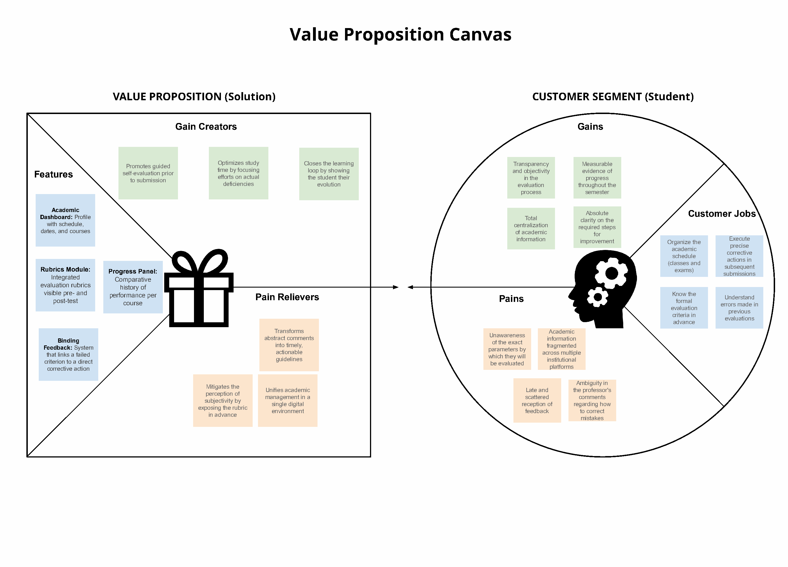
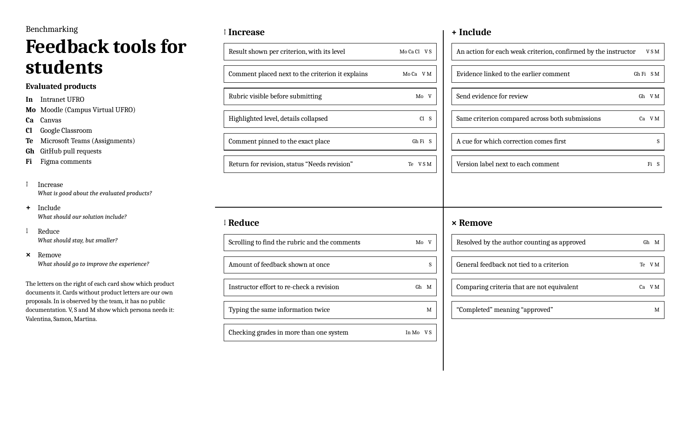
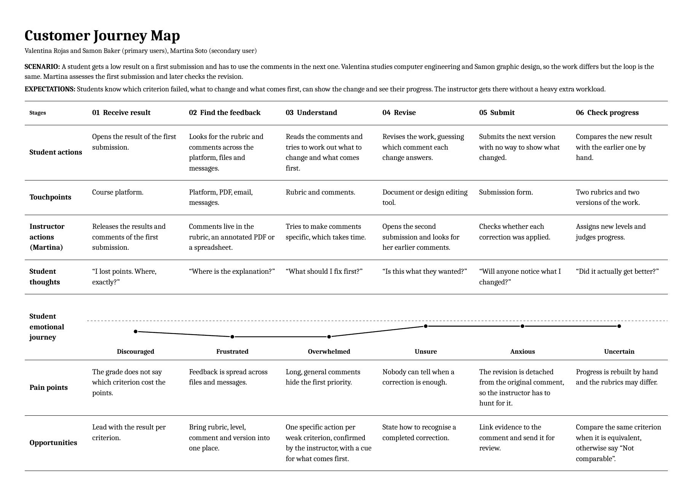

# Redo

*Feedback on assessments that students actually use*

Documentation repository for the UX project of **group 5**. The project aims to turn the feedback on an assessment into a concrete correction in the next submission, and to let students check their progress by rubric criterion.

## Team

| Member |
| --- |
| Cristian Sandova |
| Emilia Toro |
| Bastian Wenckhans |

## Selected project

Feedback on assignments and rubrics arrives late and scattered across PDF comments, spreadsheets and emails. This makes it hard for students to understand what failed and to apply the comments before their next submission.

The challenge is to **close the feedback loop**: identify the criterion that failed, understand which concrete action corrects it, and check whether there was an improvement over the previous submission. The functional surface is small, and the design focus is on the clarity of the information and on evidence that the feedback was used.

### Main user story

> As a student who got a low grade on the first submission, I need to see exactly which criterion failed and what I should do differently next time, so that I do not repeat the same mistake without noticing.

### Design goal

Design an experience that connects **evaluated criterion → detected difficulty → improvement action → evidence of application → result of the next submission**.

The value proposition is to help students turn the comments of an assessment into understandable and verifiable actions for their next piece of work.

The [project brief](docs/project-brief.md) develops the problem, the proposed scope and the questions to validate with users.

## Completed activities

### 1. UX personas

Three distinct profiles were created, with different fields, institutions and roles. Two represent the students who receive and apply the feedback. The third represents the instructor who gives it and reviews the evidence of correction.

The profiles are **empirical UX Personas grounded in qualitative user research** conducted through semi-structured in-depth interviews with undergraduate engineering students, design students, and university instructors. The full qualitative protocol, interview transcripts, and thematic syntheses are documented in the [User Research & Fieldwork Interviews PDF](docs/user-research-interviews.pdf).

| Persona | Age | Field and role | Institution | Relation to the solution |
| --- | --- | --- | --- | --- |
| Valentina Rojas | 20 | Computer engineering student, primary user. | Universidad de La Frontera | Identifies the failed criterion, follows a corrective action and compares her result in the next submission. |
| Samon Baker | 21 | Graphic design student and intern, primary user. | INACAP | Gathers comments by project, prioritizes revisions and links each action to evidence of the change in his design. |
| Martina Soto | 29 | University instructor in education, secondary user. | Universidad Católica de Temuco | Relates comments to criteria and actions, reviews the evidence of correction and compares results across submissions. |

The three profiles are set in Temuco, Chile. Their differences point to concrete interaction needs: clarity for Valentina, prioritization for Samon and follow-up on application for Martina.

#### Valentina Rojas


#### Samon Baker


#### Martina Soto


- [View the PDF with the three UX personas](docs/user-personas.pdf).
- [View the User Research & Fieldwork Interviews PDF](docs/user-research-interviews.pdf).

The profiles are written in English and share a structure of personal information, biography, goals, frustrations, personality, interests and needs. The layout places the photo on the left and the information in two columns on the right. Only the name appears over the photos, while the field, institution and role appear in the personal information.

### 2. Value Proposition Canvas

The Value Proposition Canvas aligns user needs with the system's core capabilities. While the initial exploratory canvas focused solely on a generic student segment, the calibrated canvas explicitly accounts for **all three validated UX Personas (Valentina, Samon, and Martina)**, closing the loop from both the student remediation and the instructor verification perspectives.

* **Calibrated Canvas (3 Personas):** [View the Calibrated Value Proposition Canvas & Strategy Brief PDF](docs/value-proposition-canvas-full.pdf).
* **Initial Exploratory Board:** [View the original Student Canvas PDF](docs/value-proposition-canvas.pdf).



| Persona / Role | Addressed Customer Jobs | Pains Relieved | Gains Created | Core UI Capability |
| :--- | :--- | :--- | :--- | :--- |
| **Valentina Rojas**<br>*(Primary Learner)* | Identify exact rubric failure and execute verifiable corrections for subsequent submission. | Eliminates abstract comments ("elaborate more") and fear of uncredited fixes. | Transparency in criteria and certainty that evidence is linked to critique. | **Prescriptive Action Cards + Evidence-Binding Module** |
| **Samon Baker**<br>*(Primary Prioritizer)* | Triage revision tasks against tight deadlines and track design version adjustments. | Resolves unranked feedback overload and lost context between prototype versions. | Prioritized task list ranked by rubric weight; clear version labeling. | **Urgency / Rubric Weight Sorting + Version Tagging** |
| **Martina Soto**<br>*(Secondary Evaluator)* | Formulate actionable feedback and verify student compliance without manual re-reading. | Eliminates 20+ hours of manual side-by-side document comparison and empty checkbox claims. | Rapid, auditable verification of corrections in a single comparative view. | **Instructor Verification Queue + 1-Click Status Approval** |

> **Scope Note:** Auxiliary functions such as general campus timetables, exam calendars, and institutional gradebooks shown in early exploratory mockups are strictly excluded from the design scope to preserve functional focus and comply with course requirements.

### 3. Benchmarking

A comprehensive exploratory and competitive UX benchmark adapted from the *Fructus Iter* methodology, designed to evaluate how educational and collaborative platforms manage the feedback-to-remediation loop.

The benchmark integrates four methodological components demanded by the course rubric:
1. **Initial Exploration Protocol (*Pauta de Exploración*):** Standardized protocol evaluating 4 user tasks under Valentina's shared scenario (receiving 1/4 on a rubric criterion, formulating actions, binding evidence, and instructor verification).
2. **Annotated Interface Teardowns (*Capturas Anotadas*):** Detailed teardowns with positive `[+]` and negative `[-]` callouts analyzing direct competitors (Moodle, Canvas LMS, Google Classroom) and collaborative tools (Trello, GitHub PRs, Figma).
3. **Synthetic Comparison & ERIC Matrix:** Qualitative comparison of feature support alongside an Opportunity Matrix (*Eliminate, Reduce, Raise, Create*).
4. **Ideation & Concept Map (*Mapa de Ideas*):** Architectural diagram connecting competitor patterns to LoopFeedback's 4 core modules (*Interactive Rubric Breakdown*, *Prescriptive Action Cards*, *Evidence-Binding Module*, and *Instructor Verification Queue*).

* **Full Report:** [View the Comprehensive 9-page UX Benchmarking Report PDF](docs/benchmarking-report.pdf).
* **Synthesis Board:** [View the original Benchmarking Board PDF](docs/Benchmarking.pdf).



| Tool | Category | Key Finding & Contribution to Design |
| --- | --- | --- |
| Moodle (Campus Virtual UFRO) | Direct Competitor | Clear rubric level highlighting, but comments are trapped inside small cells and resubmissions overwrite past history. |
| Canvas LMS | Direct Competitor | Criterion-level remarks via SpeedGrader, but lacks student-driven evidence binding and cross-submission comparison. |
| Google Classroom | Direct Competitor | Clean expandable score chips, but private feedback is separated from specific rubric criteria. |
| Trello | Analogous Reference | Strong mental model for checkable action cards and file attachments; adopted for our prescriptive action cards. |
| GitHub (Pull Requests) | Analogous Reference | Line-by-line granular critique and re-requesting review; inspires our bidirectional evidence binding. |
| Figma (Comments) | Analogous Reference | In-situ pinned feedback and version comparison history. |
| Intranet UFRO | Baseline Reference | Static grade display with no rubric or formative remediation mechanism. |

### 4. Customer Journey Map

A single general journey, not one per persona, in six stages: receive the result, find the feedback, understand it, revise, submit and check progress. It includes scenario, expectations, actions, touchpoints, instructor actions, thoughts, emotional curve, pain points and opportunities. It starts from Valentina Rojas and Samon Baker as primary users and Martina Soto as the secondary user.



[View the customer journey map PDF](docs/customer-journey-map.pdf).

The thoughts and emotions are an example case built from the personas and must be validated with users.

## Proposed functional scope

These functions describe the design direction for a prototype. Their implementation and validation are pending.

1. **Assessment review:** see criteria, the level or score obtained and the associated comment.
2. **Improvement action:** understand what to change, why, and how to recognize that the correction is done.
3. **Application record:** link the action to a specific fragment, section or change in the next submission.
4. **Comparison across submissions:** review the result of the same criterion when the rubrics are comparable.

The initial experience can focus on one course and two related submissions. The instructor acts as a secondary user: she links comments to criteria and actions, and reviews the evidence provided by the student. Notifications can help students learn that comments are available, but they do not show that the comments were understood or applied.

## Proposed main flow

1. The student opens the feedback on the first submission.
2. They identify a criterion that did not reach the expected level.
3. They review an explanation and a concrete improvement action linked to that criterion.
4. They apply the action in the next submission and record where the change was made.
5. The instructor reviews the change linked to the action and evaluates the new submission.
6. The student compares the result for that criterion with the previous submission, when the rubrics are equivalent.

### Illustrative example

This example explains the proposal. It is not a finding and does not come from a test.

| Step | Example |
| --- | --- |
| Criterion | Justification of design decisions. |
| Difficulty | The first submission presents a decision without linking it to user evidence. |
| Concrete action | Add the evidence that supports the decision and explain how it relates to the user's problem. |
| Evidence of application | Point to the section of the second submission where that justification was added. |
| Check | Review the level reached on the same criterion in the second assessment. |

## Traceability of design decisions

The following table links needs described in the materials to design proposals and ways to validate them. It does not represent research results.

| Need or difficulty | Proposed response | Evidence to collect |
| --- | --- | --- |
| Not knowing which criterion failed | Present criterion, result and comment together. | The student correctly identifies the criterion and explains the difficulty. |
| Not understanding what to correct | Show a specific action and a relevant example. | The student explains in their own words what they will change. |
| Reviewing separate files and emails | Bring the feedback of the submission into one view. | They find the relevant comment without going through several sources. |
| Repeating mistakes | Link improvement actions to evidence in the next submission. | A concrete change linked to the earlier comment is identified. |
| Not recognizing progress | Compare the result of the same criterion across submissions. | They recognize whether performance improved, stayed the same or got worse. |
| Little time to review design projects | Prioritize actions and gather comments by version. | The student finds a relevant action and points to the change made. |
| Instructor difficulty verifying application | Link evidence in the next submission to each earlier comment. | The instructor identifies the correction and evaluates it against the same criterion. |

## Proposed validation

The proposal is to test the prototype with engineering and design students who have received feedback and must make a related later submission. Instructors would help review the clarity of the actions and the effort of verifying corrections. An initial test can ask participants to locate a weak criterion, explain the correction, record evidence and read the comparison across submissions.

| Dimension | Proposed indicator |
| --- | --- |
| Understanding of the problem | Share of participants who correctly identify the criterion to improve. |
| Clarity of the action | Share who describe a concrete correction consistent with the comment and the rubric. |
| Ease of use | Time, errors and help needed to find and understand the feedback. |
| Application | Share of actions with relevant evidence in the next submission. |
| Progress | Change in level or score on the same criterion across comparable assessments. |

**Opening a comment or marking a task as done does not show by itself that the feedback was applied.** Applying it requires evidence in the work. A better grade does not show by itself that the tool caused the improvement either. Numeric targets and test sizes will be defined when the research is prepared.

## Status and next steps

| Activity | Status |
| --- | --- |
| Initial definition of the problem and the user story | Available. |
| UX personas | Three validated empirical profiles grounded in qualitative fieldwork interviews. |
| Value Proposition Canvas | Completed. Calibrated for all three personas (Valentina, Samon, Martina) and focused on feedback loop without auxiliary clutter (docs/value-proposition-canvas-full.pdf). |
| Benchmarking | Completed. Full 9-page benchmark including exploration protocol, annotated teardowns, comparison matrix, ERIC matrix, and concept map (docs/benchmarking-report.pdf). |
| Customer Journey Map | Available. General journey based on the personas, validation pending. |
| Research with students and instructors | Completed. Semi-structured interviews conducted with students and instructors; evidence attached in docs. |
| Flow and prototype design | Proposed. No prototypes attached. |
| Usability testing and application tracking | Pending. |
| High-fidelity interface proposal | Pending. |

The next steps are to adjust the canvas to the feedback loop, contrast the journey with real cases, and design a prototype that makes it possible to check the relation between comment, correction and later submission.

## Repository contents

```text
.
├── README.md
├── docs/
│   ├── project-brief.md
│   ├── user-research-interviews.pdf
│   ├── user-personas.pdf
│   ├── value-proposition-canvas-full.pdf
│   ├── value-proposition-canvas.pdf
│   ├── benchmarking-report.pdf
│   ├── benchmarking.pdf
│   └── customer-journey-map.pdf
├── ux-personas/
│   ├── 1.png
│   ├── 2.png
│   └── 3.png
└── images/
    ├── value_proposition.png
    ├── benchmarking.png
    └── customer-journey-map.png
```

The documentation is in English across all documents in `docs/` and the repository root. The next iteration of the canvas should consider the three current profiles.

This repository documents a UX proposal. The delivered files do not include a runnable application, so there are no installation or run instructions.
